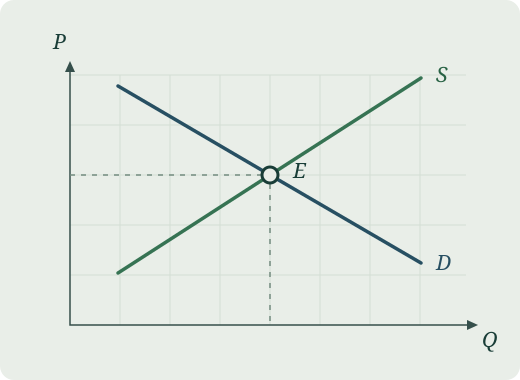

::::: {.home-hero}

:::: {.hero-intro}

[개인 홈페이지 · ECONOMICS]{.eyebrow}

# Hyeongjin {.unnumbered}

경제학을 공부하는 대학원생입니다. 수업에서 배운 모형을 다시 풀어 보고, 논문을 읽으며 생긴 질문을 이곳에 정리합니다.

::: {.hero-links}
[소개 보기 →](about.qmd){.primary-link} [GitHub](https://github.com/Hyeongjin3544){.text-link}
:::

::::

::: {.hero-figure}
{fig-alt="가로축은 거래량 Q, 세로축은 가격 P다. 우하향하는 수요곡선 D와 우상향하는 공급곡선 S가 균형점 E에서 교차한다."}

[그림 01 · 수요와 공급의 균형](notes/linear-market.qmd){.figure-link}
:::

:::::

:::: {.home-notes}

::: {.notes-intro}

[STUDY NOTES]{.eyebrow}

## 경제학 노트

수업에서 배운 모형과 논문을 읽으며 남긴 질문을 주제별로 모읍니다.
:::

[노트 목록 보기 →](notes.qmd){.text-link}
::::
