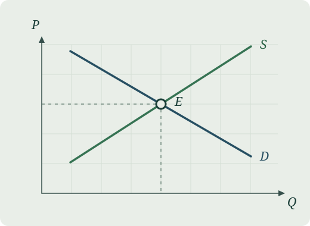

이 글은 개인 노트의 첫 예시입니다. 한 시장에서 수요가 늘어날 때, 균형 가격과 거래량이 각각 얼마나 변할까요?

## 시장청산

가격을 $P$, 수요량과 공급량을 각각 $Q_d$, $Q_s$라고 두겠습니다. $a,c>0$, $b,d>0$인 선형 모형을 사용합니다.

$$
Q_d = a - bP, \qquad Q_s = c + dP.
$$

$a>c$이면 양의 균형 가격이 존재합니다. 시장청산 조건 $Q_d=Q_s$에서

$$
P^* = \frac{a-c}{b+d},
\qquad
Q^* = c+dP^* = \frac{ad+bc}{b+d}.
$$

{width=540}

## 수요가 늘어나면

모든 가격에서 수요량이 $\Delta a>0$만큼 늘고 다른 모수는 그대로라고 합시다. 새 균형과 기존 균형의 차이는 다음과 같습니다.

$$
\Delta P^* = \frac{\Delta a}{b+d},
\qquad
\Delta Q^* = \frac{d\,\Delta a}{b+d}.
$$

예를 들어 $b=d=2$인 시장에서 수요량이 모든 가격에서 12만큼 늘면, 균형 가격은 3, 균형 거래량은 6만큼 올라갑니다. 공급의 가격 반응 $d$가 더 클수록 같은 수요 증가에 대해 가격 상승폭은 작아지고 거래량 증가폭은 커집니다.

[경제학 노트 목록으로 돌아가기](../notes.qmd)
